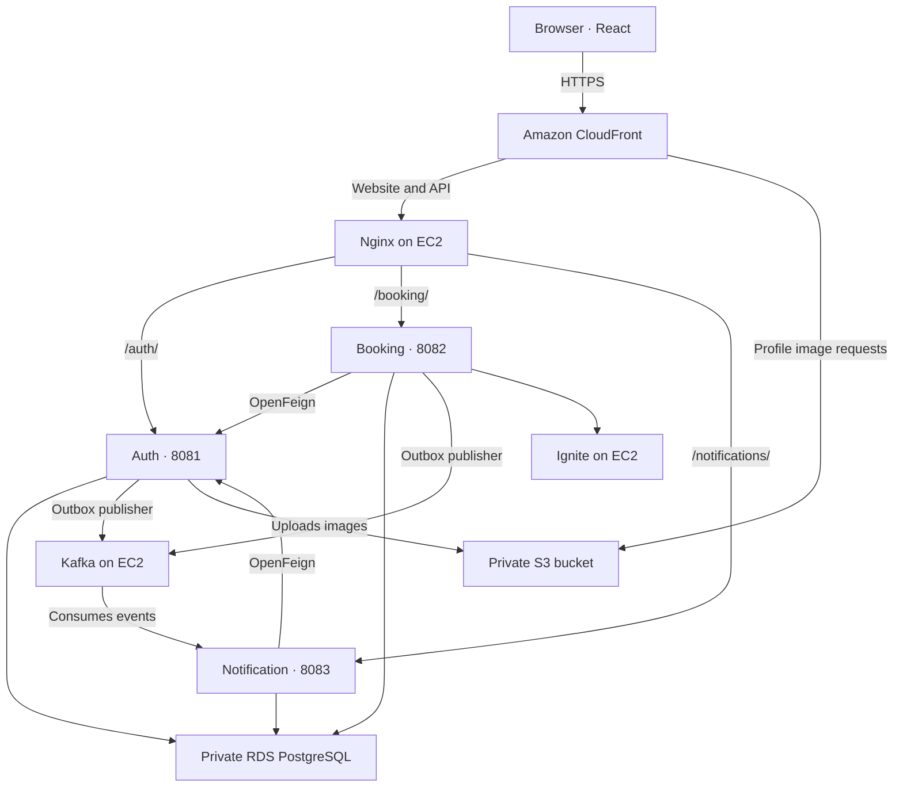
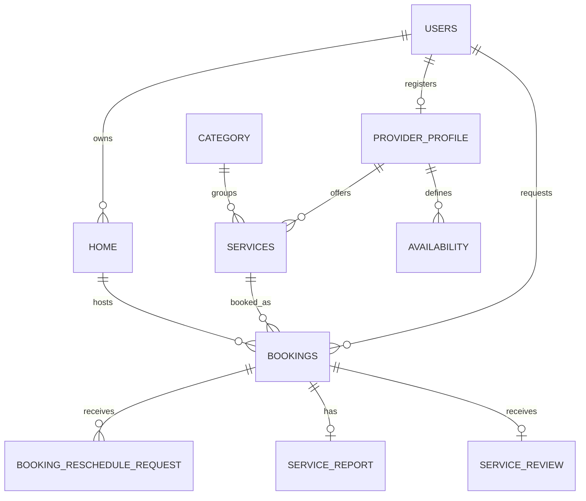
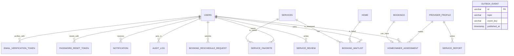
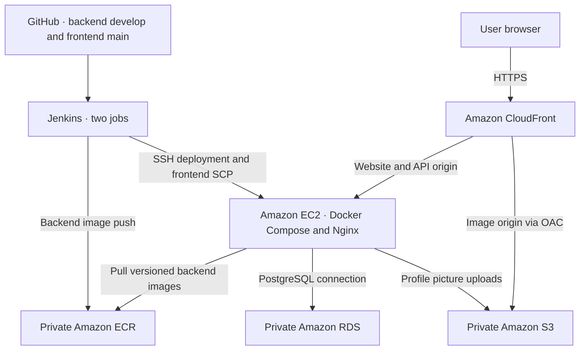

# HomeHub

HomeHub is a web application for booking and managing home maintenance services. It was built by **Israa Husain** for the General Assembly Java bootcamp. Project 4 takes the Project 3 application from a single Spring Boot backend to three deployable services with a React frontend, automated builds and an AWS deployment.

Finding a provider, agreeing on a time and following up on a job can take several calls or messages. HomeHub gives homeowners one place to find a service and follow the appointment. It gives providers a calendar and a place to respond to requests. Administrators review provider applications and manage the service categories.

**Live application** · [Open HomeHub](https://d2msjnz9ty687f.cloudfront.net)  
**Frontend source** · [HomeHub-Frontend](https://github.com/Israa-Husain/HomeHub-Frontend)  
**Backend source** · This repository. Jenkins builds the `develop` branch.

## User workflows

| Role | What the user can do |
| --- | --- |
| Homeowner | Verify an account, manage saved homes, browse categories and services, save favorites, check availability, request an appointment, cancel or request a reschedule under the booking rules, join a waitlist and review completed work. |
| Provider | Create a business profile, apply for approval, publish offerings and prices, set working hours, block time off, respond to requests and reschedules, and file a service report before completing work. Providers can also write an internal homeowner assessment in the applicable booking context. |
| Administrator | Review provider applications, manage categories, inspect user accounts and deactivate accounts as needed. |
| Signed-in users | Update their profile and profile picture, change their password and read notifications. Account recovery uses a password reset email. |

A homeowner with a leaking tap can find **Basic Plumbing Repair**, a 60-minute service listed at **BHD 15** in the deployed example. They select a saved home and a time. HomeHub checks the provider's approval, the offering, the working hours and whether another appointment overlaps. A valid request is saved as pending and the provider can confirm it. After the visit, the provider submits a report and completes the booking. The homeowner can then leave a review.

Regular bookings require advance notice. An eligible same-day emergency service can be booked with a surcharge, subject to current availability and provider and offering settings. Booking times use Bahrain time. Waitlist offers have expiry times, and rescheduling rechecks the requested slot before moving the booking.

## Architecture and microservices



### Auth Service

Auth owns accounts, password hashes, roles, account status, email verification and password-reset tokens. It registers users, verifies email addresses, authenticates logins, issues JWTs, manages profile details and handles profile-picture uploads. It exposes internal account lookup operations for the other services and records account-level audit activity. Verification and reset emails are requested through Kafka and delivered by Notification Service.

Keeping this responsibility together means one service controls the account lifecycle and decides whether a user is active. Booking and Notification can check current account information when needed, including after a user presents an existing token.

### Booking Service

Booking owns the marketplace and the appointment lifecycle. It manages homes, provider applications and approvals, service categories, offerings, availability and time off. It handles bookings, cancellation, emergency requests, rescheduling, waitlists, favorites, reports, reviews and assessments. It records booking activity and publishes events when users need to be notified. Apache Ignite supports cacheable category reads.

Booking keeps the provider calendar and the operations that change it in the same service. A booking, a reschedule and a new time-off period can all affect the same provider's time. Keeping those operations together lets them use the same database locks and transaction boundary.

### Notification Service

Notification consumes Kafka events from Auth and Booking. It delivers email through SMTP for email events and stores in-app notifications for inbox events. It exposes notification history, unread counts and read-state changes over HTTP. Server-Sent Events (SSE) let the browser receive live updates while the connection is open. Users can retrieve saved history after reconnecting.

This boundary gives delivery its own retry and error handling. SMTP latency or a temporary broker outage can delay a message while the booking itself remains recorded.

### Why three services?

The split follows three responsibilities that change for different reasons. Auth controls identity and access, Booking controls the marketplace and appointment rules, and Notification handles delivery. Each has its own Spring Boot application, image, configuration and runtime port.

Separating categories, homes, availability and bookings into additional services would have added network calls and coordination to workflows that share the same calendar and business rules. Keeping them in Booking made it possible to preserve the Project 3 concurrency safeguards with fewer deployment dependencies. The three services currently share a private RDS database. Ownership of business logic is separated at the application level, with shared-schema constraints still present in the deployed design.

### How the services communicate

- **OpenFeign** is a declarative HTTP client. A Java interface describes the internal Auth API and Spring creates the client. Booking or Notification uses it when a request needs current account information. The calling service waits for the HTTP response. Inside Compose, the services use the Auth container's DNS name and internal port.
- **Kafka** carries events that can be processed later. Auth and Booking publish notification requests. Notification consumes them on its own schedule.
- **Nginx** receives browser traffic through CloudFront. It serves React and forwards API requests by path prefix. Browser calls use one public origin for the site and APIs.

## Kafka and notifications

| Item | HomeHub implementation |
| --- | --- |
| Broker | Apache Kafka 4.1.2 in KRaft mode, running as one Compose container. Applications reach it at `kafka:9092`. |
| Main topic | `homehub.notifications.v1`. Auth and Booking use the version 1 notification event contract. |
| Producers | Auth's outbox publisher sends requests such as verification and password reset emails. Booking's outbox publisher sends booking and scheduling notifications, such as a new request, a booking decision, a reminder or a waitlist offer. |
| Consumer | Notification Service listens in the `homehub-notification-v1` consumer group. It interprets the event and handles the requested delivery. |
| Dead-letter topic | `homehub.notifications.v1.DLT` holds consumer records that exhaust the configured retries. The checked Notification configuration retries transient failures three times with a two-second interval. Invalid event contracts go directly to the dead-letter topic. An operator can inspect the failure and decide whether it is safe to replay. |
| Production topology | One broker and replication factor 1. Kafka provides asynchronous delivery, with a single broker as a point of failure. |

On a valid booking request, Booking writes the booking and an outgoing event to PostgreSQL in the same transaction. The outgoing record is called an **outbox event**. A publisher reads committed outbox rows and sends them to Kafka. If publishing fails, the event remains available for retry. If Kafka accepts a record and the publisher stops before marking it sent, a retry can publish the same event again. Notification uses the event identity to suppress repeated inbox writes. SMTP is an external side effect, so a crash after an SMTP server accepts a message can still result in duplicate email.

Useful operational checks include looking for growing unpublished outbox rows, recurring publisher errors, consumer lag and dead-letter records. A green application health endpoint alone does not prove that a specific email or notification was delivered.

## Database, scheduling and caching

Production uses one private Amazon RDS PostgreSQL database named `homehub`. The supplied schema export has 18 tables. Administrative and booking audit activity is recorded in `audit_log`. Account token data, booking state, notifications and pending outgoing events survive application container replacement.

| Area | Physical tables |
| --- | --- |
| Accounts | `users`, `email_verification_token`, `password_reset_token` |
| Marketplace and schedule | `home`, `provider_profile`, `category`, `services`, `availability` |
| Booking workflows | `bookings`, `booking_reschedule_request`, `booking_waitlist`, `service_favorite`, `service_report`, `service_review`, `homeowner_assessment` |
| Messaging and audit | `notification`, `outbox_event`, `audit_log` |

### Entity relationship diagram

The diagrams and foreign-key table describe the 18 tables in the supplied schema export. The Notification source also uses a receipt repository for deduplication. Verify its runtime table against the schema for the image being deployed.





| Table | Foreign-key columns and parent tables |
| --- | --- |
| `users` | None |
| `email_verification_token` | `user_id → users.id` |
| `password_reset_token` | `user_id → users.id` |
| `home` | `owner_id → users.id` |
| `provider_profile` | `user_id → users.id` |
| `category` | None |
| `services` | `provider_id → provider_profile.id`, `category_id → category.id` |
| `availability` | `provider_id → provider_profile.id` |
| `bookings` | `customer_id → users.id`, `home_id → home.id`, `service_id → services.id` |
| `booking_reschedule_request` | `requester_id → users.id`, `booking_id → bookings.id` |
| `booking_waitlist` | `homeowner_id → users.id`, `home_id → home.id`, `service_id → services.id` |
| `service_favorite` | `homeowner_id → users.id`, `service_id → services.id` |
| `service_report` | `provider_id → provider_profile.id`, `booking_id → bookings.id` |
| `service_review` | `homeowner_id → users.id`, `booking_id → bookings.id` |
| `homeowner_assessment` | `author_id → provider_profile.id`, `homeowner_id → users.id`, `booking_id → bookings.id` |
| `notification` | `recipient_id → users.id` |
| `audit_log` | `user_id → users.id` |
| `outbox_event` | None |

### Preventing double bookings

Two homeowners can see the same time as available before either submits. During booking, the application locks the provider record in PostgreSQL, checks relevant appointments and availability again, then saves and commits. The second request waits for that provider lock and checks the newly committed calendar before proceeding. The lock is in the database so it coordinates transactions across application processes. Rescheduling and time-off changes also need to respect the provider calendar.

Scheduled Booking tasks handle reminders and time-based expiry rules, including expiring waitlist offers. Ignite is used for category discovery reads. Booking decisions still use the current database state under the relevant lock.

## Technologies

| Layer | Tools and purpose |
| --- | --- |
| Frontend | React and Vite for the browser application and static production build. |
| Backend | Java 17, Spring Boot, Spring MVC, Spring Security, JWT and Maven Wrapper. |
| Service calls | Spring Cloud OpenFeign for internal REST calls. |
| Persistence | PostgreSQL with Spring Data JPA and Hibernate. |
| Events and live updates | Apache Kafka, Spring Kafka, SMTP and SSE. |
| Cache | Apache Ignite for category discovery reads. |
| Runtime | Docker, Docker Compose and Nginx. |
| Delivery | GitHub, Jenkins, SSH, SCP and Amazon ECR. |
| Cloud | Amazon EC2, RDS, S3, CloudFront, IAM, VPC and security groups. |
| Documentation and tests | OpenAPI/Swagger, Maven test reports, Cucumber scenarios and frontend automated tests. |

## Local development and Docker

### Run the source locally

Prerequisites are JDK 17, Docker with Compose, Node.js/npm, PostgreSQL and Kafka. Use development credentials and a separate local database. Initialize the schema expected by the checked-out backend before starting the applications. Use the configuration defaults and example files from the checkout as the source of truth for that revision.

From the backend repository root, run each command in its own terminal:

```bash
sh ./mvnw -f services/auth-service/pom.xml spring-boot:run
sh ./mvnw -f services/booking-service/pom.xml spring-boot:run
sh ./mvnw -f services/notification-service/pom.xml spring-boot:run
```

Set Auth to port 8081, Booking to 8082 and Notification to 8083. For host processes, configure the Auth URL and Kafka bootstrap address as host-reachable endpoints. Compose DNS names such as `auth-service` and `kafka` are for containers on the Compose network.

From the frontend repository root:

```bash
npm ci
npm run dev
```

Use the frontend's `.env.example` and Vite configuration to map local API requests to the three running services. The production Vite build uses the relative API bases `/auth`, `/booking` and `/notifications`. These paths rely on the production Nginx routing or equivalent local proxy rules.

### Build the backend images

Run from the backend repository root. Jenkins uses the same service-selection build argument:

```bash
docker build --build-arg SERVICE=auth-service -t homehub-auth:local .
docker build --build-arg SERVICE=booking-service -t homehub-booking:local .
docker build --build-arg SERVICE=notification-service -t homehub-notification:local .
```

The deployed Compose file, `~/homehub/docker-compose.prod.yaml` on EC2, uses registry images and an `IMAGE_TAG` supplied by Jenkins or the deployment environment. It runs Auth, Booking, Notification, Kafka and Ignite. PostgreSQL is supplied by RDS in production. One-time host configuration, including Nginx and the protected environment file, is separate from the repo checkout.


## Configuration

Store private server values in the deployment environment or Jenkins Credentials. Keep browser-facing Vite values separate because Vite embeds them in the distributed assets.

| Setting | Purpose |
| --- | --- |
| `DB_URL`, `DB_USERNAME`, `DB_PASSWORD` | PostgreSQL connection used by the services. Use the private RDS endpoint in production. |
| `JWT_SECRET`, `INTERNAL_API_KEY` | JWT signing and validation, and authorization for internal service requests. Use separate secret values. |
| `SERVER_PORT`, `SERVER_ADDRESS` | App listener inside each container. Compose publishes app ports to EC2 loopback for Nginx. |
| `AUTH_SERVICE_URL` | Internal Auth base URL for service-to-service HTTP calls. |
| `SPRING_KAFKA_BOOTSTRAP_SERVERS` | Spring Kafka connection override used in production Compose. The checked-out properties may also expose `KAFKA_BOOTSTRAP_SERVERS` for local runs. |
| `HOMEHUB_EVENTS_TOPIC`, `HOMEHUB_EVENTS_DLT`, `KAFKA_REPLICATION_FACTOR`, `KAFKA_CONCURRENCY` | Topic names and broker/consumer settings. |
| `APP_BASE_URL`, `CORS_ORIGINS` | Public base URL for account links and allowed browser origins. |
| `HOMEHUB_STORAGE_BUCKET`, `HOMEHUB_STORAGE_PUBLIC_BASE`, `AWS_REGION` | Auth upload bucket, public image delivery base URL and AWS region. |
| `IGNITE_ADDRESS`, `HOMEHUB_CACHE_ENABLED`, `SCHEDULING_ENABLED` | Booking cache connection, cache switch and scheduled jobs. |
| `MAIL_ENABLED`, `MAIL_HOST`, `MAIL_PORT`, `MAIL_FROM`, `MAIL_USERNAME`, `MAIL_PASSWORD` | Notification SMTP settings. |
| `MAIL_SMTP_AUTH`, `MAIL_STARTTLS`, `MAIL_TLS_REQUIRED` | SMTP authentication and transport configuration. |
| `HOMEHUB_SEED_ENABLED`, `HOMEHUB_DEMO_ENABLED` | Production switches for seed data and demo functionality, both disabled. |
| `IMAGE_TAG` | Common ECR tag used by all three application containers for a backend release. |

## API documentation

Each service exposes its own API. The public prefix is forwarded by Nginx to the service's internal paths. For example, the provider profile request goes to `/booking/api/providers/profile`.

| Service | Public prefix | Endpoint groups |
| --- | --- | --- |
| Auth | `/auth/` | Registration, login, verification, password recovery and user profile operations under the Auth API. |
| Booking | `/booking/` | `/api/booking`, `/api/providers`, `/api/categories`, `/api/services`, `/api/homes`, `/api/availability`, `/api/reschedules`, `/api/waitlist`, `/api/favorites`, `/api/reports`, `/api/reviews`, `/api/assessments` and booking administration. |
| Notification | `/notifications/` | `/api/notifications` and its unread count, read-state and stream operations. |

For request bodies, parameters, responses and authorization rules, inspect each service's OpenAPI output at `/v3/api-docs` and Swagger UI at `/swagger-ui/index.html` on its local port when enabled. Protected calls use a Bearer JWT and are subject to role and resource checks. Internal service endpoints use the internal API credential and should remain on the service network.

## CI/CD with Jenkins

**Continuous integration (CI)** checks a change by compiling the code, running tests and building a release artifact. **Continuous delivery and deployment (CD)** publish those artifacts and update the running application using a defined procedure.

Two jobs share one Jenkins installation running in Docker on a Windows laptop. They check out separate repositories because the backend and frontend have separate changes, branch settings and artifacts. EC2 serves the deployed application independently of the laptop. Jenkins must be available to detect changes and run new releases.

### Backend job · `develop`

| Stage | What Jenkins does |
| --- | --- |
| Checkout | Cleans the workspace and checks out the configured Git revision. |
| Tool checks | Verifies the configured JDK 17 and Maven Wrapper. |
| Build and verify | Runs Maven `clean verify` separately for Auth, Booking and Notification. A failed required build prevents image publication and deployment. |
| Package | Builds three Docker images using the repository Dockerfile and each service's build argument. |
| Publish | Authenticates to private ECR with the Jenkins-managed AWS credential, tags each image `build-<Jenkins build number>` and pushes to the three ECR repositories. |
| Deploy | Connects to EC2 over SSH using the Jenkins deployment credential and pinned host key. EC2 authenticates to ECR, pulls all three new images, then Compose replaces the application containers. |
| Verify release | Waits for container readiness and checks the three local `/actuator/health` URLs. On success it persists the release tag. On a failed replacement or health check it attempts to restore the previous tag and leaves the build failed. |
| Report | Publishes available JUnit output, archives available Cucumber reports and fingerprints successful JAR artifacts. |

A common tag ties the three backend artifacts to one release. The deploy procedure assumes the previous three services were already on a common tag. Image rollback restores application binaries. Database changes need their own compatibility and recovery plan. Jenkins prevents concurrent backend builds in the job and applies build retention and timeout settings.

### Frontend job · `main`

1. Check out the frontend Git revision.
2. Run `npm ci` so dependency installation follows the lockfile, then run automated tests and the Vite production build.
3. Package the static build and transfer it to EC2 over SCP using Jenkins-managed SSH access.
4. Activate the files served by Nginx and verify the deployment. The deployment can restore the previous index if its verification fails.

The frontend job uses polling configuration and has a successful manually triggered run. The backend job has a successful SCM-triggered run. See the release evidence section for what those runs verified.

## AWS deployment

### AWS services and why HomeHub uses each one

| AWS component | What it does in this deployment |
| --- | --- |
| **EC2** | Runs the application host. Nginx serves the React files and proxies API paths. Docker Compose runs Auth, Booking, Notification, Kafka and Ignite. |
| **ECR** | Stores the three private, versioned backend images in `eu-north-1`. Jenkins pushes them and EC2 pulls them. ECR stores the release artifacts. EC2 runs them. |
| **RDS for PostgreSQL** | Provides persistent database storage at a private endpoint. Apps on EC2 connect within the VPC. The initial schema was imported from a schema-only PostgreSQL export. |
| **S3** | Stores profile-picture objects in the private `homehub-uploads` bucket. Auth writes objects under `profiles/` and records their delivery URL. |
| **CloudFront** | Gives viewers a public HTTPS URL. Website and API traffic go to Nginx on EC2. The `/profiles/*` behavior uses S3. The viewer connection uses HTTPS and the configured EC2 origin hop uses HTTP. |
| **CloudFront Origin Access Control** | Lets the distribution retrieve images from the private S3 origin under a scoped bucket policy. Profile images can be retrieved through their CloudFront URLs. |
| **IAM** | Controls access to AWS resources. The EC2 role supplies runtime AWS access for ECR pulls and authorized S3 uploads. Jenkins uses its own credentials to publish images. |
| **VPC and security groups** | Keep RDS private and define which traffic reaches EC2 and PostgreSQL. RDS accepts PostgreSQL from the application host's security group. The EC2 web ingress was scoped to CloudFront origin-facing traffic and the operator's allowed access. SSH is restricted to the deployment/operator source. |

### How a release reaches AWS



### Initial provisioning

1. Create the three ECR repositories `homehub-auth`, `homehub-booking` and `homehub-notification` in `eu-north-1`.
2. Provision EC2 and private RDS PostgreSQL. Attach the runtime IAM role, allow PostgreSQL access from the EC2 security group, then import the matching schema into `homehub`. The deployed services validate the schema rather than creating it on startup.
3. Install Docker, Compose, Nginx and the AWS CLI on EC2. Place the production Compose file and protected `.env` in `~/homehub`. Configure the three application ports for host loopback. Configure the Nginx site root, API prefix routing and SPA fallback. For SSE, ensure the proxy supports streaming without buffering and allows the required connection duration.
4. Create the private S3 bucket and configure CloudFront with EC2 and S3 origins. Attach Origin Access Control for S3, grant the distribution access to the image prefix and route `/profiles/*` to that origin. Keep personalized API responses uncached and forward the headers and query information the API needs.
5. Configure the public URL for the browser and for account links. Configure Jenkins ECR and SSH credentials, trusted EC2 host keys, the backend `develop` job and frontend `main` job.
6. Run the backend pipeline, confirm the image tag and health of all three services, then run the frontend pipeline. Open the public address, sign in and verify the relevant workflows.

### Inspect a release on EC2

```bash
cd ~/homehub
sudo docker compose -f docker-compose.prod.yaml config --quiet
sudo docker compose -f docker-compose.prod.yaml ps -a
sudo docker compose -f docker-compose.prod.yaml logs --since 15m auth-service booking-service notification-service
curl -fsS http://127.0.0.1:8081/actuator/health
curl -fsS http://127.0.0.1:8082/actuator/health
curl -fsS http://127.0.0.1:8083/actuator/health
```

Check from the browser through CloudFront as well. Local health confirms the processes are serving their health endpoints. Browser checks also cover CloudFront, Nginx, the frontend and protected API requests.

## Testing and release evidence

| Check | Evidence available |
| --- | --- |
| Backend CI and EC2 deployment | Jenkins HomeHub build **#8** started from an SCM change and passed all pipeline stages. Compose on EC2 showed all three `build-8` service containers healthy. |
| Frontend CI and deployment | Jenkins HomeHub-Frontend build **#2** passed checkout, test/build and deployment. A prior frontend source check reported 20 automated tests passing and a successful Vite production build. |
| Browser smoke tests | Live homeowner sign-in and account page, provider business profile submission and admin approval were exercised. An image upload and retrieval through the deployed setup were checked. |
| Backend scenarios | Service-level JUnit and Cucumber assets cover Auth, Booking and Notification behavior. Jenkins archives reports produced by the configured run. |

To rerun the main checks locally:

```bash
sh ./mvnw -B -ntp -f services/auth-service/pom.xml clean verify
sh ./mvnw -B -ntp -f services/booking-service/pom.xml clean verify
sh ./mvnw -B -ntp -f services/notification-service/pom.xml clean verify
```

In the frontend checkout, run `npm ci`, `npm test` and `npm run build`. Review the configured Cucumber runner and test profile for any service-specific fixture setup before running integration scenarios. For a booking smoke test, use an approved provider with a future available slot, a homeowner with a saved home, and a provider session to confirm the request. Verify the resulting booking state and notification separately.

## Planning, submission and credits

The project moved from a single booking backend to service extraction, Kafka delivery, container builds, two Jenkins pipelines, AWS provisioning and live smoke tests. The user stories in [User workflows](#user-workflows), the architecture diagram and ERD, API groups, configuration notes and release evidence form the project documentation. Submission evidence can include the Jenkins pipeline runs, EC2 container status and browser workflow screenshots with account details and credentials removed.

| Resource | Used for |
| --- | --- |
| [Spring Boot documentation](https://docs.spring.io/spring-boot/) and [Spring Cloud OpenFeign documentation](https://docs.spring.io/spring-cloud-openfeign/reference/) | Application configuration, Actuator and internal REST clients. |
| [Apache Kafka documentation](https://kafka.apache.org/documentation/) and [Spring for Apache Kafka](https://docs.spring.io/spring-kafka/reference/) | Topics, producers, consumers and delivery errors. |
| [PostgreSQL locking documentation](https://www.postgresql.org/docs/current/explicit-locking.html) | Database locking concepts for appointment concurrency. |
| [Apache Ignite documentation](https://ignite.apache.org/docs/) | Category caching and thin-client connectivity. |
| [Docker Compose documentation](https://docs.docker.com/compose/) and [Nginx documentation](https://nginx.org/en/docs/) | Container orchestration, network routing and serving the frontend. |
| [Jenkins Pipeline documentation](https://www.jenkins.io/doc/book/pipeline/) | Build stages, credentials and artifact reporting. |
| [AWS EC2](https://docs.aws.amazon.com/ec2/), [ECR](https://docs.aws.amazon.com/ecr/), [RDS](https://docs.aws.amazon.com/rds/), [S3](https://docs.aws.amazon.com/s3/) and [CloudFront](https://docs.aws.amazon.com/cloudfront/) | Cloud deployment, image storage, managed PostgreSQL and profile image delivery. |
| [Cucumber documentation](https://cucumber.io/docs/) and [Vite documentation](https://vite.dev/guide/) | Behavior scenarios and frontend builds. |
| [Codex](https://openai.com/codex/) | Frontend development. |

